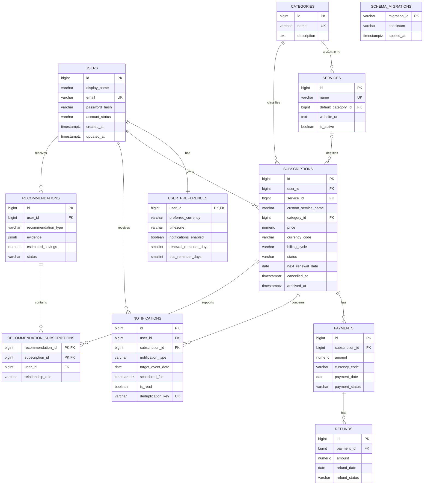

# SpendWise AI Entity-Relationship Diagram

This diagram represents migrations `001_initial_schema.sql` through `003_notification_target_dates.sql`. Crow's-foot markers show cardinality; `o` marks an optional relationship. `schema_migrations` is an operational table used by the migration runner and has no domain relationships.

## Relationship rules

- A user has exactly one preferences row after account creation; the foreign key also serves as the preferences primary key.
- A subscription belongs to one user and one category. It identifies either one shared service or one custom service name, never both.
- `services.default_category_id` is optional. A subscription's required category is the user's explicit classification and can override the service default.
- Payments and refunds are historical events. Their `RESTRICT` relationships prevent accidental loss of financial history.
- A notification may omit a subscription only for a system notification. Its composite foreign key ensures a referenced subscription belongs to the same user.
- A recommendation can involve zero or many subscriptions through `recommendation_subscriptions`. Composite foreign keys prevent cross-user links.
- The application archives subscriptions with `archived_at`; it does not physically delete them during ordinary use.
