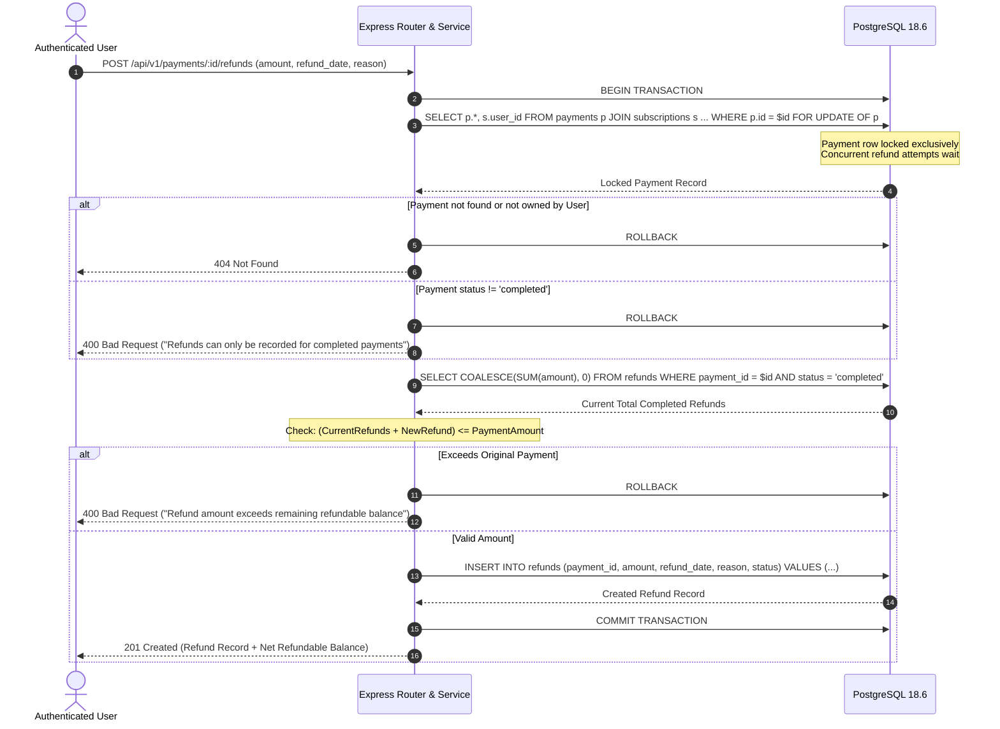

# Stage 6 — Payment Tracking & Billing Management

## 1. Executive Summary

SpendWise AI Stage 6 delivers full-stack database-backed payment tracking, manual refund recording, billing schedule management, and recurring cost calculations. Authenticated users can record real historical payments for active, paused, trial, or cancelled subscriptions, audit payment details, log partial or full refunds, track billing periods, monitor upcoming renewals, and examine estimated recurring expenditure grouped strictly by currency.

SpendWise AI is an informational subscription tracking platform, not an automated payment gateway. All payments represent user-attested external financial transactions. The system enforces strict financial integrity invariants: historical snapshotting prevents past records from retroactively mutating upon subscription price adjustments; renewals and overdue alerts are strictly forward-looking projections that never auto-generate phantom completed payment records; and PostgreSQL row-level locks guarantee refund concurrency safety.

---

## 2. Architecture & Design Principles

```
┌────────────────────────────────────────────────────────────────────────┐
│                        React 19 Frontend                               │
│                                                                        │
│  /payments            /payments/new          /payments/:id             │
│  (History, Filters)   (Manual Payment Form)  (Details, Refund, Edit)   │
│                                                                        │
│  /billing                                                              │
│  (Recurring Cost Cards by Currency, Upcoming & Overdue Renewals)       │
│                                                                        │
│  Components:                                                           │
│  - PaymentTable        - PaymentCard          - PaymentFilters         │
│  - PaymentStatusBadge  - RefundModal          - EditPaymentModal       │
│  - RecurringCostCard   - UpcomingRenewalCard                           │
└───────────────────────────────────┬────────────────────────────────────┘
                                    │ Axios HTTP (Bearer Access Token)
┌───────────────────────────────────▼────────────────────────────────────┐
│                       Express 5 REST API                               │
│                                                                        │
│  /api/v1/payments                 /api/v1/billing                      │
│  - GET / (List, filter, sort)     - GET /overview (Cost by currency)   │
│  - GET /:id (Details + refunds)   - GET /upcoming (Renewal schedule)   │
│  - PATCH /:id (Controlled edit)                                        │
│  - POST /:id/refunds (Safe refund)                                     │
│  - GET /:id/refunds (List refunds)                                     │
│                                                                        │
│  /api/v1/subscriptions/:id/payments                                    │
│  - GET / (Payments for sub)       - POST / (Record payment for sub)    │
│                                                                        │
│  Middleware:                                                           │
│  - authenticate (JWT validation & session verification)                │
│  - validateBody & validateQuery (Zod strict validation)                │
└───────────────────────────────────┬────────────────────────────────────┘
                                    │ Parameterized SQL queries
                                    │ (Node-postgres pool & transactions)
┌───────────────────────────────────▼────────────────────────────────────┐
│                    PostgreSQL 18.6 Database                            │
│                                                                        │
│  Tables:                                                               │
│  - subscriptions (user-owned parent entity)                            │
│  - payments (historical monetary events snapshotting price & currency) │
│  - refunds (partial or full reversal records tied to completed pay)    │
│                                                                        │
│  Integrity Invariants:                                                 │
│  - Row-level lock (SELECT ... FOR UPDATE OF p) for refund concurrency  │
│  - Safe integer cent arithmetic (cents = Math.round(amount * 100))     │
│  - Strict user isolation via subscriptions JOIN user_id = $userId      │
└────────────────────────────────────────────────────────────────────────┘
```

### Key Architectural Tenets

1. **Manual Financial Record Tracking:** SpendWise AI does not interact with external banking rails, card networks, or payment processors (e.g., Stripe, Razorpay). Users record real transactions completed externally. The platform never charges cards, moves funds, or initiates banking refunds.
2. **Historical Immutability & Snapshots:** Each payment record captures the amount, currency, and billing period as a historical snapshot. If the parent subscription's price or billing cycle changes later, historical payment records remain unchanged.
3. **Safe Fixed-Precision Decimal Arithmetic:** JavaScript IEEE-754 floating-point drift is avoided by normalizing monetary amounts to integer cents for all comparison and subtraction operations (`cents = Math.round(val * 100)`), stored in PostgreSQL as `NUMERIC(12, 2)`.
4. **Strict Currency Separation:** Monetary amounts in different currencies (e.g., USD, INR, EUR) are never combined into a single sum. Aggregates and recurring costs are grouped strictly by currency code.
5. **No Auto-Insertion of Expected Payments:** Upcoming and overdue renewals are forward projections. Arriving at or exceeding a renewal date never automatically creates a completed payment record.
6. **Concurrency-Safe Refund Tracking:** Creating a refund executes inside a PostgreSQL transaction (`database.withTransaction`) acquiring an exclusive row lock (`SELECT ... FOR UPDATE OF p`) on the parent payment. The sum of completed refunds can never exceed the parent payment amount, even under concurrent requests.

---

## 3. Database Schema & Relational Integrity

Stage 6 utilizes the normalized Stage 3 relational schema defined in `server/db/migrations/001_initial_schema.sql`. No additional schema alterations were required.

### Table: `payments`

Stores historical payment transactions tied to subscriptions.

| Column | Type | Constraints & Modifiers | Description |
| :--- | :--- | :--- | :--- |
| `id` | `BIGINT` | `GENERATED ALWAYS AS IDENTITY PRIMARY KEY` | Unique payment identifier |
| `subscription_id` | `BIGINT` | `NOT NULL, REFERENCES subscriptions(id) ON DELETE CASCADE` | Associated subscription |
| `amount` | `NUMERIC(12, 2)` | `NOT NULL, CHECK (amount > 0)` | Actual amount paid |
| `currency_code` | `VARCHAR(3)` | `NOT NULL, CHECK (currency_code ~ '^[A-Z]{3}$')` | ISO 4217 3-letter currency code |
| `payment_date` | `DATE` | `NOT NULL` | Date when the payment took place |
| `payment_status` | `VARCHAR(20)` | `NOT NULL, CHECK IN ('pending', 'completed', 'failed')` | Status of the payment |
| `billing_period_start`| `DATE` | `NULLABLE` | Start of coverage interval |
| `billing_period_end` | `DATE` | `NULLABLE, CHECK (billing_period_end >= billing_period_start)` | End of coverage interval |
| `notes` | `TEXT` | `NULLABLE, CHECK (char_length(notes) <= 2000)` | Optional user entry notes |
| `created_at` | `TIMESTAMPTZ` | `NOT NULL, DEFAULT CURRENT_TIMESTAMP` | Row creation timestamp |
| `updated_at` | `TIMESTAMPTZ` | `NOT NULL, DEFAULT CURRENT_TIMESTAMP` | Row modification timestamp |

### Table: `refunds`

Stores partial or full reimbursement events tied to a parent payment.

| Column | Type | Constraints & Modifiers | Description |
| :--- | :--- | :--- | :--- |
| `id` | `BIGINT` | `GENERATED ALWAYS AS IDENTITY PRIMARY KEY` | Unique refund identifier |
| `payment_id` | `BIGINT` | `NOT NULL, REFERENCES payments(id) ON DELETE CASCADE` | Parent payment reference |
| `amount` | `NUMERIC(12, 2)` | `NOT NULL, CHECK (amount > 0)` | Refunded amount |
| `refund_date` | `DATE` | `NOT NULL` | Date when the refund was issued |
| `reason` | `TEXT` | `NULLABLE, CHECK (char_length(reason) <= 2000)` | Optional refund rationale |
| `status` | `VARCHAR(20)` | `NOT NULL, CHECK IN ('pending', 'completed', 'failed')` | Status of the refund |
| `created_at` | `TIMESTAMPTZ` | `NOT NULL, DEFAULT CURRENT_TIMESTAMP` | Row creation timestamp |

### Indexes & Performance

- `idx_payments_subscription_id`: B-Tree index on `payments(subscription_id)` for subscription payment listings.
- `idx_payments_payment_date`: B-Tree index on `payments(payment_date DESC)` for chronologically sorted payment queries.
- `idx_payments_status`: B-Tree index on `payments(payment_status)` for status-filtered aggregation.
- `idx_refunds_payment_id`: B-Tree index on `refunds(payment_id)` for fast refund history lookups.

---

## 4. Financial Integrity Rules

### Rule 1 — Manual Tracking Acknowledgment
SpendWise AI maintains records of payments that occurred in the real world. A recorded payment does not trigger card charges or bank transfers. The UI prominently displays disclaimers that logging payments or refunds is an administrative tracking tool.

### Rule 2 — Separation of Expected vs. Completed Expenditure
Realized spending is strictly calculated from payments with `payment_status = 'completed'`. Pending payments, failed payments, and future renewal projections are completely excluded from realized expenditure totals.

### Rule 3 — Historical Value Preservation
A payment records what was actually paid at that point in time. If a subscription plan cost is later modified from $15.00 to $20.00, past payment records of $15.00 remain intact.

### Rule 4 — Currency Isolation
Monetary calculations never mix currency codes. The recurring cost endpoint (`/api/v1/billing/overview`) groups estimates strictly by currency code (e.g., `USD`, `INR`).

### Rule 5 — Concurrency-Safe Refund Integrity
A refund can only be logged against a payment with `payment_status = 'completed'`. Under no circumstance may the sum of completed refunds exceed the original payment amount. Row-level locking (`SELECT ... FOR UPDATE OF p`) prevents race conditions during concurrent refund submissions.

### Rule 6 — User Isolation
All financial database operations join `subscriptions` and filter on `subscriptions.user_id = $authenticatedUserId`. Users cannot read, create, update, or refund payments belonging to other accounts. Any access attempt targeting another user's record returns an immediate `404 Not Found`.

---

## 5. Payment Correction Policy

To balance accounting auditability with practical human-entry corrections, SpendWise AI enforces a controlled edit policy via `PATCH /api/v1/payments/:id`:

1. **Permitted Editable Fields:**
   - `amount` (Monetary amount)
   - `payment_date` (Calendar date)
   - `payment_status` (`pending`, `completed`, `failed`)
   - `billing_period_start` & `billing_period_end` (Coverage interval)
   - `notes` (Entry notes)
2. **Refund Protection Guards:**
   - If a payment has associated `completed` refund records, its status **cannot** be changed to `pending` or `failed`.
   - The payment `amount` cannot be reduced below the cumulative sum of existing `completed` refunds.
3. **Billing Period Consistency:**
   - If both `billing_period_start` and `billing_period_end` are provided, the end date must be on or after the start date.

---

## 6. Refund Lifecycle & Concurrency Control



---

## 7. Billing Schedules & Recurring Cost Calculations

### Normalized Monthly Cost Projections

For active and trial subscriptions (`status IN ('active', 'trial')` and `archived_at IS NULL`), recurring monthly costs are calculated using standard interval divisors:
- **Monthly:** $\text{MonthlyCost} = \text{Price}$
- **Quarterly:** $\text{MonthlyCost} = \frac{\text{Price}}{3}$
- **Yearly:** $\text{MonthlyCost} = \frac{\text{Price}}{12}$

All amounts are rounded to 2 decimal places and grouped strictly by currency code:
```json
{
  "costsByCurrency": [
    {
      "currency_code": "INR",
      "monthly_total": "1498.00",
      "yearly_total": "17976.00",
      "active_subscriptions_count": 3
    },
    {
      "currency_code": "USD",
      "monthly_total": "19.99",
      "yearly_total": "239.88",
      "active_subscriptions_count": 1
    }
  ]
}
```

### Upcoming & Overdue Renewals Window

- Endpoint: `GET /api/v1/billing/upcoming?days=30`
- Filters active and trial subscriptions whose `next_renewal_date` falls between `today` and `today + days`.
- **Overdue Detection:** Subscriptions where `next_renewal_date < CURRENT_DATE` are flagged with `is_overdue: true` and `days_overdue: N`.
- **Integrity Rule:** Overdue subscriptions display a warning banner prompting the user to record their payment manually. No phantom payments are inserted automatically.

---

## 8. REST API Specifications

All endpoints require authentication via `Authorization: Bearer <accessToken>`.

### 1. `GET /api/v1/payments`
Retrieve paginated, filtered payment history for the authenticated user.

**Query Parameters:**
- `page` (integer, default 1)
- `limit` (integer, default 10, max 100)
- `subscription_id` (integer, optional)
- `status` (`pending` | `completed` | `failed`, optional)
- `currency_code` (3 uppercase letters, optional)
- `start_date` (ISO date `YYYY-MM-DD`, optional)
- `end_date` (ISO date `YYYY-MM-DD`, optional)
- `sort_by` (`payment_date` | `amount` | `created_at`, default `payment_date`)
- `sort_dir` (`asc` | `desc`, default `desc`)

**Response (200 OK):**
```json
{
  "status": "success",
  "data": {
    "payments": [
      {
        "id": 10,
        "subscription_id": 4,
        "service_name": "Netflix",
        "category_name": "Entertainment",
        "amount": "649.00",
        "currency_code": "INR",
        "payment_date": "2026-10-14",
        "payment_status": "completed",
        "billing_period_start": "2026-10-14",
        "billing_period_end": "2026-11-13",
        "total_refunded": "0.00",
        "net_amount": "649.00",
        "created_at": "2026-10-14T10:00:00Z"
      }
    ],
    "pagination": {
      "page": 1,
      "limit": 10,
      "total_items": 1,
      "total_pages": 1
    }
  }
}
```

### 2. `POST /api/v1/subscriptions/:id/payments`
Record a manual payment for a specific owned subscription.

**Request Body:**
```json
{
  "amount": "649.00",
  "currency_code": "INR",
  "payment_date": "2026-10-14",
  "payment_status": "completed",
  "billing_period_start": "2026-10-14",
  "billing_period_end": "2026-11-13",
  "notes": "Paid via UPI"
}
```

**Response (201 Created):**
```json
{
  "status": "success",
  "data": {
    "payment": {
      "id": 11,
      "subscription_id": 4,
      "amount": "649.00",
      "currency_code": "INR",
      "payment_date": "2026-10-14",
      "payment_status": "completed",
      "billing_period_start": "2026-10-14",
      "billing_period_end": "2026-11-13",
      "notes": "Paid via UPI",
      "created_at": "2026-10-14T10:30:00Z"
    }
  }
}
```

### 3. `GET /api/v1/payments/:id`
Fetch single payment details including net refundable balance and list of refunds.

**Response (200 OK):**
```json
{
  "status": "success",
  "data": {
    "payment": {
      "id": 11,
      "subscription_id": 4,
      "service_name": "Netflix",
      "amount": "649.00",
      "currency_code": "INR",
      "payment_date": "2026-10-14",
      "payment_status": "completed",
      "total_refunded": "100.00",
      "net_amount": "549.00",
      "refunds": [
        {
          "id": 1,
          "amount": "100.00",
          "refund_date": "2026-10-15",
          "reason": "Billing dispute resolved",
          "status": "completed"
        }
      ]
    }
  }
}
```

### 4. `PATCH /api/v1/payments/:id`
Correct a manually entered payment record under the integrity policy.

**Request Body:**
```json
{
  "amount": "649.00",
  "notes": "Updated note with reference number"
}
```

**Response (200 OK):**
```json
{
  "status": "success",
  "data": {
    "payment": { ... }
  }
}
```

### 5. `POST /api/v1/payments/:id/refunds`
Record a partial or full refund for a completed payment.

**Request Body:**
```json
{
  "amount": "200.00",
  "refund_date": "2026-10-15",
  "reason": "Service downtime compensation",
  "status": "completed"
}
```

**Response (201 Created):**
```json
{
  "status": "success",
  "data": {
    "refund": {
      "id": 2,
      "payment_id": 11,
      "amount": "200.00",
      "refund_date": "2026-10-15",
      "reason": "Service downtime compensation",
      "status": "completed",
      "created_at": "2026-10-15T02:00:00Z"
    }
  }
}
```

### 6. `GET /api/v1/billing/overview`
Get estimated monthly and yearly recurring costs grouped strictly by currency.

**Response (200 OK):**
```json
{
  "status": "success",
  "data": {
    "costsByCurrency": [
      {
        "currency_code": "INR",
        "monthly_total": "1498.00",
        "yearly_total": "17976.00",
        "active_subscriptions_count": 3
      }
    ]
  }
}
```

### 7. `GET /api/v1/billing/upcoming`
List upcoming renewals and overdue renewals for active and trial subscriptions.

**Query Parameters:**
- `days` (integer, default 30, max 365)

**Response (200 OK):**
```json
{
  "status": "success",
  "data": {
    "upcoming": [
      {
        "id": 4,
        "service_name": "Netflix",
        "price": "649.00",
        "currency_code": "INR",
        "billing_cycle": "monthly",
        "next_renewal_date": "2026-10-25",
        "is_overdue": false,
        "days_until_renewal": 10
      }
    ]
  }
}
```

---

## 9. Frontend User Interface

The React 19 client provides intuitive, accessible, and responsive financial management views:

1. **Payments Page (`/payments`):**
   - Summary statistics cards: Total Recorded Payments, Total Realized Spending by Currency.
   - Filtering toolbar: Subscription selector, status filter, currency code filter, date range pickers.
   - Responsive presentation: High-density desktop table and mobile-optimized card layout.
   - Direct link to record new payment or view payment details.
2. **Record Payment Page (`/payments/new`):**
   - Subscription selector automatically prefilling currency and default amount.
   - Billing period start/end calculation helper based on billing cycle.
   - Clear manual tracking disclaimer.
3. **Payment Details Page (`/payments/:id`):**
   - Financial breakdown: Original Amount, Total Refunded, Net Amount.
   - Coverage interval and entry notes.
   - Refund history table with status badges.
   - Action modals for **Record Refund** (with remaining balance validation) and **Edit Payment** (with refund protection warnings).
4. **Billing Overview Page (`/billing`):**
   - Recurring cost cards separated strictly by currency (Monthly & Yearly projections).
   - Overdue renewals alert box highlighting subscriptions requiring manual payment confirmation.
   - Upcoming renewals schedule with countdown badges and quick "Record Payment" buttons.

---

## 10. Automated Testing & Verification

The Stage 6 implementation is backed by extensive automated test suites across both backend and frontend workspaces.

### 1. Backend PostgreSQL Integration Tests (`server/tests/payment.integration.test.js`)
Executed live against PostgreSQL 18.6 test database (`spendwise_test`):
- **User Ownership & Isolation:** Verifies User A cannot view, edit, or refund payments belonging to User B.
- **Controlled Payment Edits:** Verifies updating amounts, dates, and notes; validates that modifying status to `failed` or reducing amount below refunds is blocked.
- **Refund Invariants:** Verifies partial refunds calculate remaining balance correctly and rejects refunds exceeding the payment amount.
- **Concurrency & Race Condition Protection:** Runs concurrent `Promise.all` requests attempting two ₹700 refunds on a ₹1000 payment; verifies that PostgreSQL row-level locks allow exactly one to succeed while rejecting the second with HTTP 400.
- **Billing Calculations & Currency Grouping:** Verifies exact monthly normalization (`P`, `P/3`, `P/12`) across multiple currencies without cross-currency mixing.
- **Overdue Renewal Detection:** Confirms past renewal dates are flagged with `is_overdue: true` without auto-generating payment records.

### 2. Frontend Component & Flow Tests (`client/src/tests/payments.test.jsx`)
Executed via Vitest and React Testing Library:
- **Payments Listing:** Verifies payment table renders records, status badges, and formatted amounts.
- **Manual Payment Recording:** Verifies form prefill, date handling, and submission navigation.
- **Refund Recording Flow:** Verifies refund modal validation, net amount display, and submission.
- **Partial Refund History:** Verifies detail view displays previous refunds and remaining refundable amount.
- **Billing Projections:** Verifies currency separation cards, upcoming renewal indicators, and overdue warnings.

### Verification Summary
- `npm test --workspace client`: 4 suites, 25 tests passed.
- `npm test --workspace server`: 8 suites, 41 tests passed.
- `npm run test:db`: 4 suites, 30 tests passed against `spendwise_test`.
- `npm run lint`: 0 errors, 0 warnings.
- `npm run format:check`: 0 formatting issues.
- `npm run build`: Production client bundle compiled in 1.34s.
