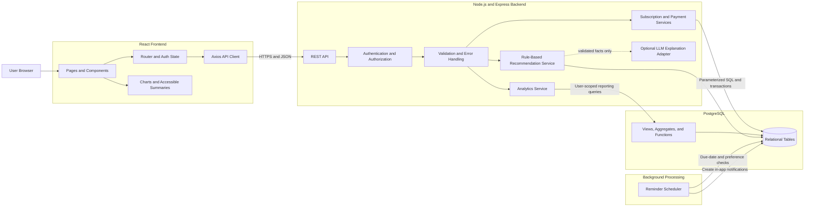

# High-Level System Architecture

## 1. Architecture Summary

SpendWise AI will use a three-tier web architecture:

1. A React single-page frontend presents forms, tables, charts, and authenticated navigation.
2. A Node.js and Express backend exposes versioned RESTful API endpoints and owns authorization, validation, business rules, and orchestration.
3. PostgreSQL persists relational data and enforces key integrity rules.

The frontend never accesses PostgreSQL directly. All reads and writes pass through the backend so authentication, ownership, validation, error handling, and auditing remain consistent.

This document is conceptual. Repository scaffolding, package selection, endpoint contracts, and deployment configuration belong to Stage 2 and later stages.

## 2. Component Responsibilities

### 2.1 React Frontend

Planned responsibilities:

- Render registration, login, dashboard, subscription, payment, notification, recommendation, profile, and preference views
- Manage routes and authenticated navigation with React Router
- Send API requests through a centralized Axios client
- Perform usability-oriented form checks while treating backend validation as authoritative
- Display loading, success, empty, and error states
- Render analytics with Recharts plus accessible summaries or alternatives
- Avoid embedding secrets or database access logic

### 2.2 Express Backend

Planned responsibilities:

- Expose REST resources under a documented versioned path
- Validate and normalize request data
- Authenticate JWTs and enforce per-resource ownership
- Hash and verify passwords using bcrypt
- Execute parameterized raw SQL through `pg`
- Coordinate transactions for multi-step consistency
- Apply billing normalization and recommendation rules in centralized services
- Return consistent response and error formats
- Provide controlled interfaces for scheduled jobs and optional external services

Likely conceptual layers are routing, middleware, controllers, domain/services, database access, validation, configuration, and shared error handling. Exact folders are deferred to Stage 2.

### 2.3 PostgreSQL Database

Planned responsibilities:

- Persist users, services, categories, subscriptions, payments, notifications, recommendations, and preferences
- Enforce primary keys, foreign keys, uniqueness, nullability, checks, defaults, and referential actions
- Support transaction isolation and atomic changes
- Execute joins, aggregates, grouping, subqueries, and reporting views
- Provide justified indexes for user-scoped, date-based, and reporting access paths
- Support narrowly justified triggers and stored functions introduced in later DBMS stages

PostgreSQL remains the integrity boundary even though the API also validates input.

## 3. Authentication and Authorization Flow

1. The frontend sends registration or login input to the API over HTTPS in deployed environments.
2. The backend validates input and hashes/verifies passwords with bcrypt.
3. On successful login, the backend issues a time-limited JWT-based credential.
4. The frontend supplies the credential for protected requests according to the security design chosen in Stage 4.
5. Authentication middleware verifies signature, expiry, and required claims.
6. Queries scope access by the authenticated user's ID, and service logic verifies ownership for nested resources.
7. The backend returns only authorized data.

Token storage, refresh strategy, revocation, and cookie/header transport require a Stage 4 threat-informed decision. A JWT alone does not replace ownership checks.

## 4. Analytics Processing

Analytics will combine SQL and backend orchestration:

- PostgreSQL performs filtering, joins, grouping, and aggregation close to the data.
- Reusable, stable reports may be represented as database views.
- The backend supplies the authenticated user scope, date ranges, status policy, and currency grouping.
- Shared calculation logic defines monthly/yearly normalization and prevents inconsistent frontend calculations.
- The frontend formats and visualizes returned metrics but does not redefine their financial meaning.

Forward estimates use current subscription terms. Historical reports use persisted payment facts. Multi-currency results remain grouped by currency in the MVP.

## 5. Reminder Scheduler

The reminder subsystem is a background worker or scheduled process conceptually separate from interactive HTTP requests. It will:

1. Run on a documented schedule.
2. Evaluate user preferences and applicable renewal/trial dates.
3. Create notifications through an idempotent operation.
4. Record enough occurrence context to prevent duplicates.
5. Log failures safely and permit retries.

Stage 9 uses a separately started Node.js reminder worker. The worker and API share repository/database conventions without embedding scheduler execution inside ordinary page requests; PostgreSQL uniqueness keeps concurrent worker instances idempotent.

## 6. AI Recommendation Service

The recommendation subsystem has two layers:

- **Deterministic rule engine:** the required baseline that evaluates stored subscription facts, comparable categories/currencies, documented thresholds, and estimated savings formulas.
- **Optional explanation provider:** a later LLM integration that may improve wording but cannot change rule results, calculated values, or invent financial facts.

Recommendations retain their rule type, evidence, state, and timestamps for traceability. If the optional provider is unavailable, the system returns the deterministic explanation.

## 7. Environment and Configuration Boundaries

Environment-based configuration will cover values such as:

- API port and runtime mode
- PostgreSQL connection settings
- JWT signing configuration and token lifetimes
- Frontend/API origins and CORS policy
- Scheduler enablement and cadence
- Optional AI provider credentials and model settings
- Logging level

Only non-secret examples belong in version control. Production values must be supplied through the deployment environment.

## 8. Conceptual Architecture Diagram

## 9. Cross-Cutting Design Decisions

- **Trust boundary:** the browser is untrusted; backend and database checks are mandatory.
- **Data ownership:** user identity comes from the verified credential, never from a client-supplied owner field.
- **SQL visibility:** raw SQL is retained to support DBMS learning objectives and query analysis.
- **Money:** fixed-precision values and explicit currency codes are required.
- **Dates and time:** storage and comparison rules will be standardized; display uses the user's time zone preference.
- **Idempotency:** scheduled jobs must safely retry without duplicate logical output.
- **Observability:** errors and important jobs are logged with diagnostic context but without secrets.
- **Evolution:** database migrations and versioned API contracts enable incremental development.

## 10. Architecture Risks to Resolve

- JWT transport, refresh, and revocation strategy
- Whether subscription deletion is restricted, soft-deleted, or allowed while preserving payment history
- Exact date/time types for renewal dates versus payment timestamps
- Scheduler technology and deployment topology
- Recommendation comparison thresholds and duplicate-suppression policy
- Optional LLM provider, privacy terms, cost controls, and failure behavior
- Supported browser matrix and measured performance targets

These decisions are intentionally deferred to the stages where implementation evidence and detailed data modeling are available.
