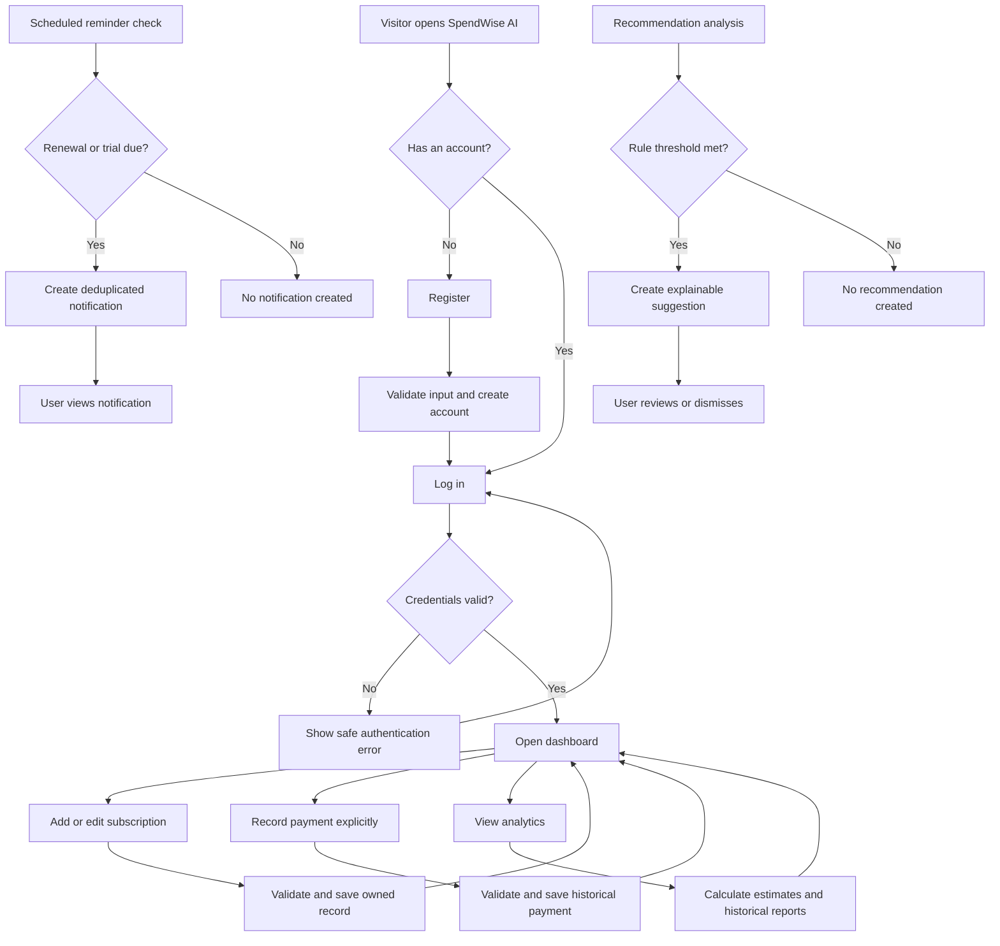

# User Workflows

## 1. Workflow Principles

- Every workflow involving personal data begins with an authenticated user.
- The backend verifies ownership regardless of what the frontend displays.
- Subscription schedules produce estimates and reminders; they do not create completed payments.
- Analytics and recommendations are derived from stored data and identify their calculation basis.

## 2. Registering and Logging In

1. A visitor opens the registration page.
2. The visitor enters the required profile fields, email, and password.
3. The frontend performs basic input checks and submits the registration request over HTTPS in deployed environments.
4. The backend validates and normalizes the input, confirms email uniqueness, hashes the password, and creates the user and default preferences atomically where appropriate.
5. The application confirms registration without exposing the password or hash.
6. The user opens the login page and submits email and password.
7. The backend verifies the credentials and issues a time-limited JWT-based authentication credential.
8. The frontend establishes the authenticated state and routes the user to the dashboard.
9. On logout, the client removes the active credential and the backend invalidates any server-managed session/refresh state if that design is adopted in Stage 4.

**Failure paths:** duplicate email, invalid input, incorrect credentials, expired token, or unavailable service produces a clear and safe error. No protected data is displayed.

## 3. Adding a Subscription

1. The authenticated user selects **Add subscription**.
2. The application presents service, category, price, currency, billing cycle, start date, next renewal date, and status fields.
3. The user enters the details and submits the form.
4. The frontend checks required fields and formats.
5. The backend validates business rules, verifies or creates the permitted service association, and assigns the record to the authenticated user.
6. PostgreSQL enforces relevant constraints and relationships.
7. The backend returns the created subscription.
8. The interface confirms success and refreshes affected subscription and estimate views.

**Failure paths:** invalid amount, unsupported currency/cycle/status, inconsistent dates, unknown category, or database failure leaves the form recoverable and creates no partial record.

## 4. Editing a Subscription

1. The authenticated user opens a subscription from their list.
2. The backend returns the record only after verifying ownership.
3. The user chooses **Edit** and changes permitted fields.
4. The frontend submits only the intended update or a complete validated edit payload according to the later API contract.
5. The backend validates input and ownership again.
6. The database updates the current subscription terms.
7. Historical payment amounts remain unchanged.
8. The interface shows the saved values and recalculates affected forward estimates.

**Failure paths:** stale/missing record, invalid data, or an unowned identifier results in a safe error and no update.

## 5. Recording a Payment

1. The authenticated user opens an owned subscription or the payment-entry workflow.
2. The user enters the amount, currency, billing/payment date, and payment status.
3. The frontend submits the payment as an explicit user action.
4. The backend validates the input and confirms ownership of the related subscription.
5. The database records the payment amount as historical information, independent of later price changes.
6. If renewal-date advancement is included in the same action, the backend performs payment creation and schedule update in a transaction.
7. The application confirms the recorded state and refreshes payment-history analytics.

**Important:** an upcoming renewal or expected payment is never automatically treated as completed. Failed or rolled-back operations leave neither a partial payment nor an inconsistent renewal schedule.

## 6. Viewing Expense Analytics

1. The authenticated user opens the dashboard or analytics page.
2. The frontend requests summary metrics and the selected reporting period.
3. The backend applies the user ID, filters, payment-status policy, billing normalization, and currency grouping.
4. PostgreSQL executes aggregates, joins, views, or reporting queries defined in later stages.
5. The backend labels results as either forward-looking estimates or historical recorded payments.
6. The frontend displays totals, category summaries, trends, upcoming renewals, and expensive subscriptions.
7. Charts include labels or accessible summaries and show empty states when no data exists.

**Important:** different currencies are displayed separately unless a future documented conversion policy is implemented.

## 7. Receiving a Renewal Reminder

1. The user enables reminders and selects a lead time in preferences.
2. A scheduled background process runs at a documented interval.
3. The process identifies active/trial subscriptions whose renewal or trial-expiration date falls in the user's reminder window.
4. It checks whether the logical reminder has already been created.
5. The system creates one in-app notification for each new qualifying occurrence.
6. The user sees an unread indicator and opens the notification center.
7. The user reads or marks the notification as read.

**Important:** the reminder describes an expected event only. It neither charges the user nor records a completed payment.

## 8. Receiving an AI Optimization Recommendation

1. The recommendation process selects the authenticated user's eligible subscription and analytics data.
2. Deterministic rules evaluate possible service overlap, cost outliers, and category concentration within comparable currencies and groups.
3. A rule produces a recommendation only when its documented preconditions and threshold are satisfied.
4. The system records or returns the triggering evidence, explanation, rule type, and estimated potential savings where applicable.
5. An optional later LLM service may rewrite the explanation using only validated facts; it cannot change calculated values.
6. The frontend presents the result as a suggestion rather than a fact about usage or guaranteed savings.
7. The user may review, dismiss, or otherwise resolve the recommendation.

**Failure paths:** insufficient data produces no recommendation; optional LLM failure falls back to the deterministic explanation.

## 9. Combined User Workflow Diagram

## 10. Workflow Validation Focus

- Authentication and ownership are rechecked on the server at each protected step.
- Multi-write operations use transactions where partial success would break consistency.
- Reminder and recommendation processes are retry-safe and avoid duplicate logical records.
- The interface never silently converts projected charges into historical spending.
- Error paths preserve entered data where safe and provide actionable, non-sensitive feedback.
