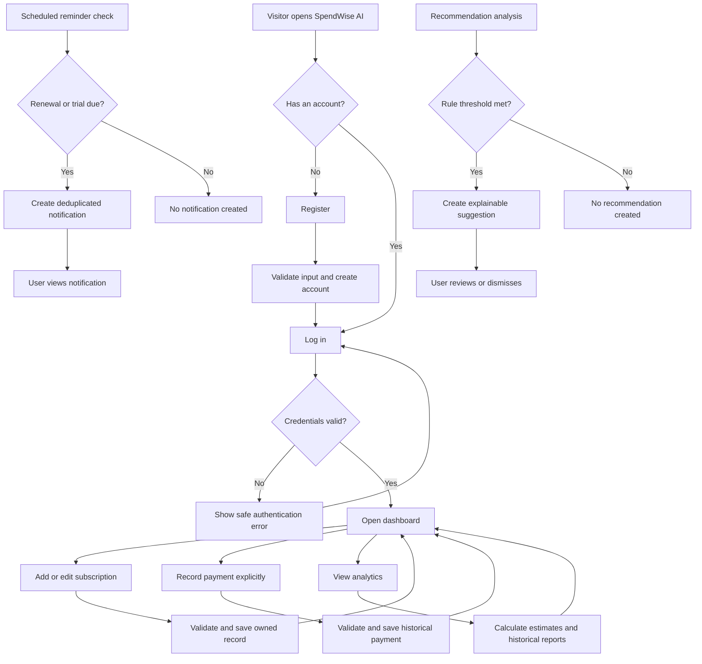

# User Workflows

## 1. Workflow Principles

- Every workflow involving personal data begins with an authenticated user.
- The backend verifies ownership regardless of what the frontend displays.
- Subscription schedules produce estimates and reminders; they do not create completed payments.
- Analytics and recommendations are derived from stored data and identify their calculation basis.

## 2. Registering and Logging In

1. A visitor opens the registration page.
2. The visitor enters the required profile fields, email, and password.
3. The frontend performs basic input checks and submits the registration request over HTTPS in deployed environments.
4. The backend validates and normalizes the input, confirms email uniqueness, hashes the password, and creates the user and default preferences atomically where appropriate.
5. The application confirms registration without exposing the password or hash.
6. The user opens the login page and submits email and password.
7. The backend verifies the credentials and issues a time-limited JWT-based authentication credential.
8. The frontend establishes the authenticated state and routes the user to the dashboard.
9. On logout, the client removes the active credential and the backend invalidates any server-managed session/refresh state if that design is adopted in Stage 4.

**Failure paths:** duplicate email, invalid input, incorrect credentials, expired token, or unavailable service produces a clear and safe error. No protected data is displayed.

## 3. Adding a Subscription

1. The authenticated user selects **Add subscription**.
2. The application presents service, category, price, currency, billing cycle, start date, next renewal date, and status fields.
3. The user enters the details and submits the form.
4. The frontend checks required fields and formats.
5. The backend validates business rules, verifies or creates the permitted service association, and assigns the record to the authenticated user.
6. PostgreSQL enforces relevant constraints and relationships.
7. The backend returns the created subscription.
8. The interface confirms success and refreshes affected subscription and estimate views.

**Failure paths:** invalid amount, unsupported currency/cycle/status, inconsistent dates, unknown category, or database failure leaves the form recoverable and creates no partial record.

## 4. Editing a Subscription

1. The authenticated user opens a subscription from their list.
2. The backend returns the record only after verifying ownership.
3. The user chooses **Edit** and changes permitted fields.
4. The frontend submits only the intended update or a complete validated edit payload according to the later API contract.
5. The backend validates input and ownership again.
6. The database updates the current subscription terms.
7. Historical payment amounts remain unchanged.
8. The interface shows the saved values and recalculates affected forward estimates.

**Failure paths:** stale/missing record, invalid data, or an unowned identifier results in a safe error and no update.

## 5. Payment & Billing Workflows

### 5.1 Recording a Manual Payment

1. The authenticated user opens the **Record Payment** page (`/payments/new`) or clicks **Record Payment** from a subscription's details view.
2. The user selects a subscription, prefilling the currency and recurring price.
3. The user confirms or adjusts the actual amount paid, payment date, coverage dates (`billing_period_start` and `billing_period_end`), payment status (`completed`, `pending`, or `failed`), and optional notes.
4. The frontend submits the explicit user-attested record to `POST /api/v1/subscriptions/:id/payments`.
5. The backend validates user ownership of the subscription, sanitizes input, and saves the historical record.
6. The payment snapshot preserves the exact amount and currency paid regardless of subsequent subscription changes.

**Important:** An upcoming renewal or expected payment is never automatically treated as completed. SpendWise AI does not process card charges.

### 5.2 Correcting a Payment Entry

1. The user navigates to **Payment Details** (`/payments/:id`) and clicks **Edit Payment**.
2. The user updates permitted fields (amount, payment date, status, billing period, notes).
3. The backend enforces refund integrity rules:
   - If completed refunds exist, status cannot be transitioned to `pending` or `failed`.
   - The payment amount cannot be reduced below the cumulative sum of completed refunds.
4. The database updates the payment record and returns the updated entity.

### 5.3 Recording a Partial or Full Refund

1. The user opens a completed payment in **Payment Details** and clicks **Record Refund**.
2. The interface calculates and displays the current remaining refundable balance.
3. The user enters the refund amount, date, and reason, selecting status (`completed` or `pending`).
4. The backend opens a PostgreSQL transaction, locks the payment row exclusively (`SELECT ... FOR UPDATE OF p`), and calculates current completed refunds.
5. If the new refund would exceed the payment amount, the transaction rolls back and returns an error.
6. If valid, the refund is inserted and the updated net refundable balance is returned.

### 5.4 Monitoring Billing Schedules & Upcoming Renewals

1. The user visits the **Billing Overview** page (`/billing`).
2. The interface displays estimated recurring costs normalized to monthly and yearly figures, grouped strictly by currency.
3. The upcoming renewal window (default 30 days) lists active and trial subscriptions.
4. If any subscription's `next_renewal_date` has passed without an updated renewal date, it is flagged as **Overdue**.
5. The user can click **Record Payment** directly from the upcoming list to log the actual payment.

**Failure paths:** Invalid amounts, unsupported currencies, date inversions, unauthorized access, or refunds exceeding balances produce safe, actionable errors without partial database state.

## 6. Viewing Expense Analytics & SQL Reports

### 6.1 Multi-Currency Financial Overview & Key Metrics

1. The authenticated user navigates to the **Analytics** page (`/analytics`).
2. The frontend requests `/api/v1/analytics/overview` (and composite `/report`) scoped to the user.
3. The interface displays distinct overview cards per currency:
   - **Gross Spending:** Total historical completed payments in the selected period.
   - **Total Refunds:** Aggregate completed refund credits.
   - **Net Spending:** Exact cash flow (`Gross - Refunds`). If refunds exceed payments in a period, the deficit is rendered accurately in green with a refund badge.
   - **Average Monthly Spending:** Normalized run-rate across the user's active billing lifespan.
   - **Active Subscriptions:** Count of currently running commitments.
4. Currencies are strictly segregated (INR, USD, etc.), ensuring non-fungible totals are never combined.

### 6.2 Filtering by Date Ranges & Quick Presets

1. The user selects a time range using the preset filter buttons:
   - **All Time**, **This Month**, **Last Month**, **Last 3 Months**, **This Year**, **Last 12 Months**, or **Custom**.
2. Selecting **Custom** reveals start and end date pickers.
3. The user can optionally select a specific currency filter.
4. All analytical tables and summary metrics immediately reload and re-evaluate date-bounded aggregates.

### 6.3 Analyzing Monthly Cash-Flow Trends & Zero-Activity Gaps

1. The user navigates to the **Monthly Trends** tab.
2. The table displays chronological rows generated by PostgreSQL's `generate_series`.
3. If no spending occurred in a given month (e.g., March between active payments in February and April), the row displays `0.00` gross, `0.00` refunds, and `0.00` net, rather than omitting the month.
4. Months with refunds exceeding payments display the true negative cash flow.

### 6.4 Inspecting Category Spending & Budget Allocation

1. The user reviews the **Category Spending** table.
2. The query uses pre-aggregated payment and refund CTEs joined to `categories`, preventing 1-to-many Cartesian multiplication when multiple refunds exist.
3. Each category displays gross payments, refunds, net spending, active subscriptions count, and percentage share of gross spending.
4. Custom services without a catalog category are categorized under their user-selected category.

### 6.5 Analyzing Subscription Spending & Identifying Top Outliers

1. The user switches to the **By Subscription** tab.
2. Server-side window functions (`COUNT(*) OVER()`) paginate through subscriptions sorted by net spending, gross spending, or payment count.
3. The **Top Subscriptions** summary highlights the highest spend subscriptions (default top 5) to quickly pinpoint cost drivers.

### 6.6 Reviewing Billing Cycles & Payment Status Distribution

1. The user views the **Billing Cycles** card, which compares total spend and active subscriptions across `monthly`, `quarterly`, `semi_annual`, and `yearly` cycles.
2. The user inspects the **Payment Status** card to audit completed, pending, failed, or refunded transaction volumes.

### 6.7 Exporting Sanitized Financial Reports to CSV

1. The user clicks the **Export CSV** button in the header toolbar.
2. The browser requests `GET /api/v1/analytics/export?startDate=...&endDate=...&currency=...`.
3. The server generates a streaming CSV containing:
   - Metadata header lines documenting export timestamp, user scope, date filters, and currency.
   - Chronological payment transaction records with payment date, service name, category, currency, gross amount, refund total, net amount, and status.
   - Chronological refund credit records with refund date, payment reference, service name, currency, refund amount, and reason.
4. All string cells starting with `=`, `+`, `-`, or `@` are prefixed with `'` to prevent spreadsheet formula injection.
5. The browser initiates a direct file download named `spendwise-analytics-[currency]-[timestamp].csv`.

**Failure paths:** Invalid dates or inverted ranges return a 400 validation error; unauthorized access returns 401; missing data returns empty state placeholders without UI crashes.

## 7. Receiving a Renewal Reminder

1. The user enables reminders and selects a lead time in preferences.
2. A scheduled background process runs at a documented interval.
3. The process identifies active/trial subscriptions whose renewal or trial-expiration date falls in the user's reminder window.
4. PostgreSQL atomically enforces one reminder per user, subscription, kind, and target date.
5. The system creates one in-app notification for each new qualifying occurrence; paused, cancelled, archived, disabled, and overdue events create none.
6. The user sees an unread indicator and opens the notification center.
7. The user reads or marks the notification as read.

**Important:** the reminder describes an expected event only. It neither charges the user nor records a completed payment.

## 8. Receiving an AI Optimization Recommendation

1. The recommendation process selects the authenticated user's eligible subscription and analytics data.
2. Deterministic rules evaluate exact duplicates, cautious category overlap, high recurring cost, historical spending concentration, renewal/trial timing, and billing-plan review within comparable currencies.
3. A rule produces a recommendation only when its documented preconditions and threshold are satisfied.
4. The system records or returns the triggering evidence, explanation, rule type, and estimated potential savings where applicable.
5. The optional provider-neutral explanation adapter is disabled by default and falls back to deterministic text; it cannot change calculated values.
6. The frontend presents the result as a suggestion rather than a fact about usage or guaranteed savings.
7. The user may review, dismiss, or otherwise resolve the recommendation.

**Failure paths:** insufficient data produces no recommendation; optional LLM failure falls back to the deterministic explanation.

## 9. Combined User Workflow Diagram

## 10. Workflow Validation Focus

- Authentication and ownership are rechecked on the server at each protected step.
- Multi-write operations use transactions where partial success would break consistency.
- Reminder and recommendation processes are retry-safe and avoid duplicate logical records.
- The interface never silently converts projected charges into historical spending.
- Error paths preserve entered data where safe and provide actionable, non-sensitive feedback.
